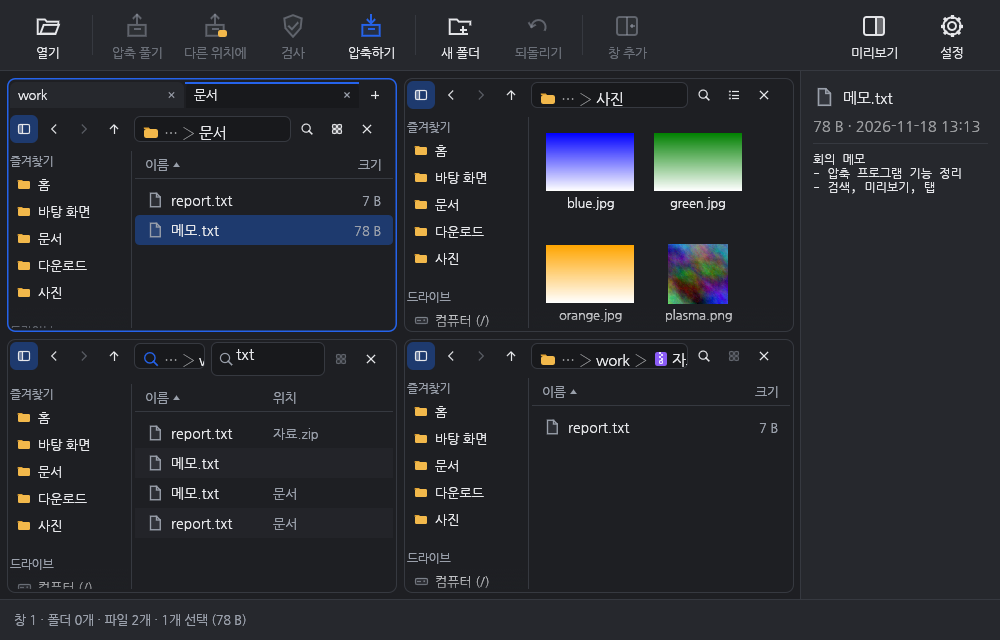
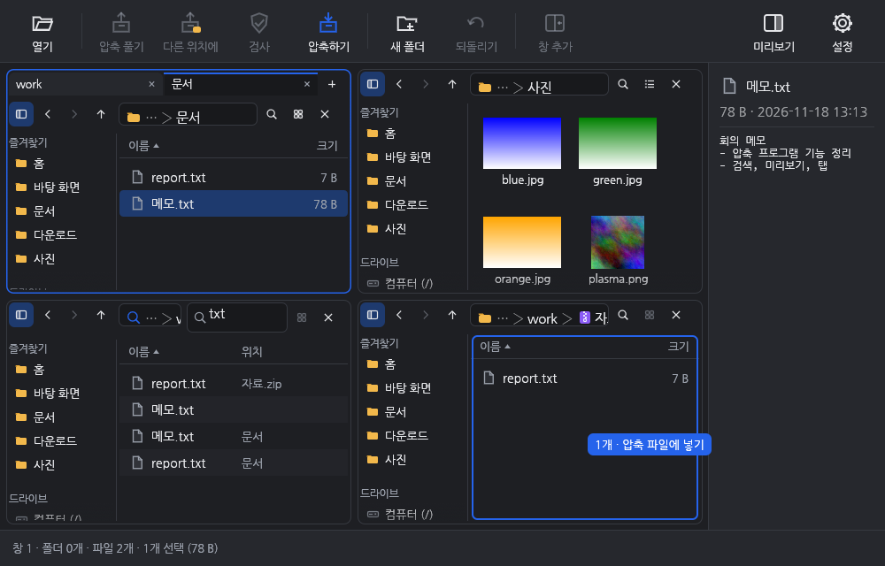

# opizenAI_Unpack

**Windows와 Linux**에서 쓰는 압축 프로그램입니다. 파일 관리자 **우클릭 메뉴**로 바로 압축을 풀거나 압축할 수 있고,
GUI 창과 명령줄 도구(`unpack`)도 함께 제공합니다. Rust로 작성되었습니다.

| | 형식 |
|---|---|
| **압축 풀기** | zip, 7z, **rar**, tar, tar.gz/tgz, tar.bz2/tbz2, tar.xz/txz, tar.zst/tzst, gz, bz2, xz, zst |
| **압축하기** | zip, 7z, tar.gz, tar.xz — **분할 압축**(700 MB, 4 GB 등으로 `.001`, `.002` …), 이미 압축된 파일(jpg·mp4·zip …)은 그대로 넣어 빠르게 |
| **압축 파일 고치기** | zip, 7z, tar.gz, tar.xz 안에 파일 넣기 · 지우기 (zip은 다시 압축하지 않아 빠르고 암호 항목도 유지) |
| **암호 (AES-256)** | zip, 7z — 풀기와 압축하기 모두 |
| **한글 이름** | 한국어 Windows에서 만든 zip(CP949 이름)도 자동으로 인식 |
| **분할 파일** | `이름.zip.001`, `이름.7z.001` … 처럼 잘라 놓은 파일 (첫 조각을 열면 이어서 읽음) |
| **그 밖에** | 진행률·취소, 압축 수준(빠르게/보통/최대), 손상 검사, 압축 폭탄 방어, 풀고 나서 휴지통으로 |

## 내려받기

[Releases](../../releases) 또는 [Actions](../../actions) 의 최신 빌드 결과(Artifacts)에서 받습니다.

| 운영체제 | 파일 | 설치 |
|---|---|---|
| Windows 10/11 (64비트) | `opizenAI_Unpack-Setup-<버전>-x64.exe` | 실행 후 안내에 따라 설치 |
| Ubuntu / Debian | `opizenai-unpack_<버전>_amd64.deb` | `sudo apt install ./opizenai-unpack_<버전>_amd64.deb` |
| 그 외 Linux | `opizenAI_Unpack-<버전>-linux-x86_64.tar.gz` | 압축을 풀고 `./install.sh` (사용자) 또는 `sudo ./install.sh` (시스템) |

> Windows: 코드 서명이 없어 처음 실행 시 SmartScreen 경고가 나올 수 있습니다. "추가 정보 → 실행"을 누르세요.

## 우클릭 메뉴

### 압축 파일을 우클릭 → `opizenAI_Unpack ▸`

| 메뉴 | 동작 |
|---|---|
| **알아서 풀기** | 안에 폴더가 하나면 그대로 풀고, 아니면 압축 파일 이름으로 폴더를 만들어 풉니다 |
| **여기에 압축 풀기** | 폴더를 만들지 않고 지금 폴더에 그대로 풉니다 (이미 있는 파일은 건너뜀) |
| **새 폴더에 압축 풀기** | 항상 압축 파일 이름의 폴더에 풉니다 |
| **opizenAI_Unpack으로 열기...** | 전체 창에서 내용 보기·옵션 지정 후 해제 |

### 아무 파일·폴더를 우클릭 → `opizenAI_Unpack 압축 ▸`

| 메뉴 | 동작 |
|---|---|
| **ZIP으로 압축** | 바로 `이름.zip` 생성 |
| **7Z로 압축** | 바로 `이름.7z` 생성 |
| **압축하기...** | 형식(ZIP/7Z/TAR.GZ/TAR.XZ), 파일 이름, 저장 위치, 암호를 고른 뒤 압축 |

- 여러 파일을 선택하고 압축하면 **압축 파일 하나**로 묶입니다 (이름은 들어 있는 폴더 이름).
- 기존 파일은 절대 덮어쓰지 않으며, 이름이 겹치면 `이름 (2)`처럼 새 이름을 씁니다.
- 작업 창은 성공하면 저절로 닫히고, 실패하거나 경고가 있으면 이유를 보여 줍니다.
- 암호가 걸린 압축 파일은 진행 창에서 암호를 입력하고 다시 시도할 수 있습니다.

### 지원하는 파일 관리자

| 운영체제 | 파일 관리자 | 비고 |
|---|---|---|
| Windows | 탐색기 | Windows 11은 설치 옵션 "우클릭 메뉴 바로 표시"(기본 선택)로 바로 나타납니다 |
| Linux | GNOME 파일 (Nautilus) | `python3-nautilus` 설치 시 우클릭 메뉴, 없으면 "스크립트" 메뉴(사용자 설치) |
| Linux | KDE Dolphin | 서비스 메뉴 |
| Linux | Cinnamon Nemo | Nemo 액션 |

### Windows 설치 옵션

| 옵션 | 기본 | 설명 |
|---|---|---|
| 탐색기 우클릭 메뉴 | 선택 | 위의 압축 풀기 / 압축하기 메뉴 |
| zip 파일 연결 | 선택 | zip을 더블클릭하면 opizenAI_Unpack이 열리고 내용을 바로 보여 줍니다 |
| 그 외 압축 파일 연결 | 해제 | 7z, tar, gz, bz2, xz, zst 도 연결 |
| Windows 11: 우클릭 메뉴 바로 표시 | 선택 | "추가 옵션 표시" 없이 바로 메뉴가 나옵니다. 모든 프로그램의 우클릭 메뉴가 Windows 10 방식으로 바뀝니다 |
| 바탕화면 바로가기 | 선택 | |

제거하면 파일 연결과 Windows 11 메뉴 설정을 설치 전 상태로 되돌립니다.
Linux에서는 `install.sh`(사용자 설치)가 zip을 opizenAI_Unpack에 연결합니다 (`NO_ASSOC=1`이면 건너뜀).

설치 후 우클릭 메뉴가 보이지 않으면 파일 관리자를 다시 시작하세요 (예: `nautilus -q`).

## GUI 창 — 파일 탐색기

 

opizenAI_Unpack의 메인 창은 **파일 탐색기**입니다. 압축 풀기·압축하기는 고른 파일에 쓰는 하위 기능입니다.
Windows/Linux의 라이트·다크 설정을 자동으로 따릅니다.

| 부분 | 설명 |
|---|---|
| **가운데 창 (최대 4개)** | **창 추가**(Ctrl+N)로 2개(좌우) · 3개 · 4개(2×2)로 나눔. **경계선을 끌어 크기 조절**(두 번 누르면 가운데로). 누른 창(파란 테두리)이 활성 창 |
| **탭 (창마다)** | Ctrl+T 새 탭, Ctrl+W 탭 닫기, Ctrl+Tab 다음 탭. 폴더 우클릭 → **새 탭에서 열기**. 가운데 단추 클릭으로도 닫힘 |
| **바로가기 (창마다)** | 즐겨찾기(홈 · 바탕 화면 · 문서 · 다운로드 · 사진 + **직접 추가한 폴더**)와 드라이브. 파일을 바로가기에 놓으면 그 폴더로 이동(Ctrl: 복사) |
| **주소 줄** | 뒤로 · 앞으로 · 위로, 경로 조각을 눌러 이동. 빈 곳을 누르거나 Ctrl+L로 경로를 직접 입력 |
| **검색** | 주소 줄 오른쪽 칸(Ctrl+F)에 쓰고 Enter — 지금 폴더와 그 아래 전부, **압축 파일 안까지** 이름으로 찾음. 띄어쓰기로 여러 낱말(모두 들어간 것) |
| **보기 방식** | 목록 ↔ **아이콘**(사진은 작은 그림으로) — 창마다 따로 |
| **미리보기** | 도구 모음 **미리보기**(Alt+P): 고른 사진·글 파일 내용, 압축 파일 요약(파일 수·풀면 크기·맨 위 항목) |
| **도구 모음** | 열기 · 압축 풀기 · 다른 위치에 · 검사 · 압축하기 · 새 폴더 · **되돌리기** · 창 추가 · 미리보기 · 설정 |
| **상태 표시줄** | 항목 수·선택 크기, 작업 진행률과 **취소**, 결과 |

- **더블클릭(Enter)**: 폴더는 들어가고, **압축 파일은 그 안으로 들어가며**, 그 밖의 파일은 기본 프로그램으로 엽니다.
- **끌어다 놓기**: 파일·폴더를 다른 창(또는 폴더 줄, 바로가기)에 놓으면 **이동**, Ctrl을 누르고 놓으면 **복사**
  (다른 드라이브로는 Windows 탐색기처럼 기본이 복사).
  - **압축 파일 안 항목 → 폴더 창**: 그곳에 풀립니다.
  - **파일 → 압축 파일 안 보기**: 압축 파일의 지금 폴더에 **넣습니다**(같은 이름은 새것으로). 압축 파일 안에서 Delete(또는 우클릭 → 지우기)는 확인한 뒤 지웁니다.
  - **폴더 → "즐겨찾기" 글자(또는 그 아래 줄)**: 즐겨찾기에 추가. 바로가기 우클릭 → 즐겨찾기에서 빼기.
- **같은 이름이 있으면 묻습니다**: 덮어쓰기(원래 것은 휴지통으로, 폴더끼리는 내용 합치기) · 둘 다 유지(`(2)`) · 건너뛰기, **남은 항목에도 똑같이** 적용 가능.
- **파일 작업**: 잘라내기 · 복사 · 붙여넣기(Ctrl+X/C/V, 창끼리도), 이름 바꾸기(F2), 새 폴더(Ctrl+Shift+N), 휴지통으로(Delete).
  **여러 개를 고르고 F2**면 `여행 (1).jpg`, `여행 (2).jpg` …로 한꺼번에(시작 번호 지정, 미리 보기). 폴더를 자기 안으로 옮기는 것은 막고, 영구 삭제는 하지 않습니다.
- **되돌리기 (Ctrl+Z)**: 이동 · 복사 · 이름 바꾸기 · 새 폴더 · 휴지통으로 보내기를 차례로 되돌립니다(최근 30개, 휴지통은 원래 자리로 되살림).
- **우클릭 메뉴**: 압축 파일 안 보기 · 새 탭에서 열기 · 즐겨찾기에 추가 · 알아서 풀기 · 여기에 / 새 폴더에 / 다른 위치에 풀기 · 검사 · 압축하기 · 파일 관리자에서 보기
- **압축 파일 안**에서는 폴더를 오가며(Backspace로 위로, 최상위에서 한 번 더 누르면 밖으로) 내용을 보고,
  파일을 더블클릭하면 임시 폴더에 풀어 바로 엽니다. 여러 개 고르면 도구 모음이 **선택 풀기**가 됩니다.
- 풀린 결과와 만든 압축 파일은 표에서 자동으로 선택되어 바로 보입니다.
- **창 배치 기억**: 창 개수 · 탭 · 각 폴더 · 바로가기/보기 방식 · 경계선 위치 · 미리보기를 다음에 열 때 그대로 되살립니다.
- 키보드: Alt+←/→/↑ (뒤로/앞으로/위로), Backspace (위로), F5 (새로 고침), Esc (선택 해제 / 검색 닫기),
  Ctrl+N (창 추가), F6 (다음 창), Ctrl+T / Ctrl+W / Ctrl+Tab (탭), Ctrl+L (경로 입력), Ctrl+F (검색), Ctrl+Z (되돌리기), Alt+P (미리보기)

**설정**(오른쪽 패널): 압축 풀 위치(같은 폴더 / 다른 폴더), 압축 형식(ZIP·7Z·TAR.GZ·TAR.XZ), 압축 수준(빠르게·보통·최대),
**분할 압축**(나누지 않음 · 100 MB · 700 MB · 4 GB · 직접 입력), **이미 압축된 파일도 다시 압축**(기본은 꺼짐: 그대로 넣어 빠르게),
암호, **풀고 나서 압축 파일을 휴지통으로**, **숨김 파일 표시**. 설정은 저장되어 다음에도 그대로입니다(암호는 저장하지 않음).
압축을 풀 때 기존 파일은 덮어쓰지 않고 이름이 겹치면 `(2)`를 붙입니다.

## 명령줄 도구 (`unpack`)

```bash
unpack archive.zip                   # archive/ 폴더에 해제
unpack data.tar.gz -o out            # out/ 폴더에 해제
unpack a.zip b.7z -o out             # out/a, out/b 로 각각 해제
unpack -l archive.7z                 # 목록만 보기
unpack -p 비밀번호 secret.zip         # 암호 걸린 zip / 7z
unpack -c 결과.zip 폴더 파일.txt      # 압축하기 (형식은 확장자: .zip .7z .tar.gz .tar.xz)
unpack -c 비밀.7z -p 비밀번호 폴더     # 암호 걸린 7z 만들기
unpack -c 작게.7z --level best 폴더    # 최대 압축 (fast / normal / best)
unpack -c 큰.zip --split 700m 폴더     # 분할 압축 → 큰.zip.001, 큰.zip.002 …
unpack -t archive.zip                # 풀지 않고 손상 검사
unpack archive.zip -i 사진/여행       # 이 항목만 풀기 (여러 번 쓸 수 있음)
unpack 영화.zip.001                  # 분할 파일 (.001, .002 … 이어서)
unpack --trash archive.zip           # 문제없이 풀리면 압축 파일을 휴지통으로
```

| 옵션 | 설명 |
|------|------|
| `-c, --create <ARCHIVE>` | 압축 파일 만들기 |
| `-o, --output <DIR>` | 출력 폴더 (기본: 압축 파일 옆, 확장자를 뺀 이름) |
| `-l, --list` | 해제하지 않고 목록 표시 |
| `-f, --overwrite` | 이미 존재하는 파일 덮어쓰기 (기본은 건너뜀) |
| `-p, --password <PW>` | zip / 7z / rar 암호 |
| `-t, --test` | 해제하지 않고 손상 검사 |
| `-i, --include <PATH>` | 이 항목만 풀기 (폴더면 그 안 전부) |
| `--level <fast\|normal\|best>` | 압축 수준 (기본 normal) |
| `--split <SIZE>` | 분할 압축: 이 크기마다 나눔 (예: `700m`, `4g`, `100k`) |
| `--always-compress` | 이미 압축된 파일(jpg·mp4·zip …)도 다시 압축 (기본은 그대로 넣음 — zip, 7z) |
| `--trash` | 문제없이 풀리면 압축 파일을 휴지통으로 |
| `--allow-large` | 압축 폭탄·디스크 공간 검사를 건너뜀 |
| `-v, --verbose` | 해제되는 항목 출력 |

## 보안

- `../`, 절대 경로, 드라이브 문자(`C:`)가 들어간 항목은 건너뜁니다 (Zip Slip 방지).
- 출력 폴더 밖을 가리키는 심볼릭 링크는 만들지 않습니다.
- 압축은 임시 파일(`*.part`)에 쓴 뒤 완료되면 이름을 바꿔, 실패하거나 취소해도 깨진 파일이 남지 않습니다.
- **압축 폭탄 방어**: 풀기 전에 남은 디스크 공간과 압축률(1 GiB 이상이면서 100배 초과)을 확인하고, 푸는 동안에도
  예상보다 훨씬 많이 쓰면 멈춥니다. 정상 파일이라면 **그래도 풀기**(CLI는 `--allow-large`)로 풀 수 있습니다.

## 직접 빌드

```bash
cargo test                             # 테스트
cargo build --release                  # CLI: target/release/unpack
cargo build --release --features gui   # GUI: target/release/opizenAI_Unpack
./build-linux.sh                       # → dist/*.deb, dist/*-linux-x86_64.tar.gz
./build-windows.sh                     # → dist/opizenAI_Unpack-Setup-*.exe (Linux에서 교차 빌드)
```

Windows 설치 파일 교차 빌드에는 `rustup target add x86_64-pc-windows-gnu`, `mingw-w64`, `nsis`가 필요합니다.
GitHub Actions가 푸시마다 두 운영체제용 파일을 빌드하며, `v*` 태그를 만들면 Release에 자동으로 첨부합니다.

## 라이선스

MIT. 단, RAR 풀기에 쓰는 UnRAR 코드는 별도의 UnRAR 라이선스를 따릅니다 — RAR를 **푸는 용도로만** 자유롭게 쓸 수 있고,
RAR 압축 프로그램을 만드는 데는 쓸 수 없습니다. 전문은 [THIRD-PARTY-NOTICES.md](THIRD-PARTY-NOTICES.md)에 있습니다.
RAR 지원 없이 빌드하려면 `--no-default-features`를 쓰세요.
